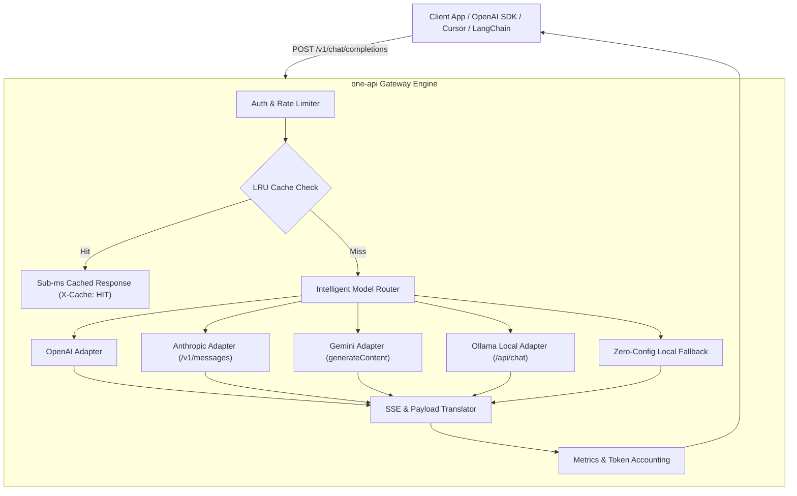

<div align="center">
  
  
  <br/>

  <h1>🌌 one-api</h1>
  <p><b>Universal Edge LLM Gateway — v2.0.0</b></p>
  <i>One API to rule them all. Unify OpenAI, Anthropic, Google Gemini, DeepSeek, Groq, Ollama, and more behind a high-performance OpenAI-compatible endpoint.</i>

  <br/>
  
  [](https://nodejs.org)
  [](https://docker.com)
  [](LICENSE)
  []()
</div>

---

## 📑 Table of Contents
- [✨ Overview](#-overview)
- [⚡ Next-Gen v2.0 Features](#-next-gen-v20-features)
- [🧠 Supported Providers](#-supported-providers)
- [🏗️ System Architecture](#️-system-architecture)
- [🚀 Quick Start](#-quick-start)
- [📡 API Reference](#-api-reference)
  - [Chat Completions (Sync & SSE Stream)](#1-chat-completions-sync--sse-stream)
  - [Models Catalog Discovery](#2-models-catalog-discovery)
  - [Telemetry & Observability](#3-telemetry--observability)
- [📦 Docker Deployment](#-docker-deployment)
- [⚙️ Advanced Configuration](#️-advanced-configuration)
- [🛠️ Client SDK Integration](#️-client-sdk-integration)
- [🧪 Development & Testing](#-development--testing)

---

## ✨ Overview

`one-api` is an ultra-fast, single-binary, production-grade LLM gateway. It abstracts provider-specific message schemas, endpoint contracts, streaming protocols, and authentication into a standard **OpenAI-compatible interface**.

Swap out your `baseURL` in any OpenAI SDK, LangChain, Cursor, or OpenWebUI application and instantly gain access to 20+ models with:
- Zero code changes
- Native Server-Sent Events (SSE) streaming translation
- In-memory semantic caching (sub-millisecond latency & zero token cost for repeat queries)
- Built-in token heuristics and telemetry
- Zero-config local fallback for offline development

---

## ⚡ Next-Gen v2.0 Features

- **🌐 100% OpenAI-Compatible Interface**: Full fidelity support for `/v1/chat/completions` and `/v1/models`.
- **⚡ Native SSE Streaming**: Real-time token streaming with automatic cross-provider chunk translation (Anthropic `text_delta` and Gemini parts translated on-the-fly to OpenAI `chat.completion.chunk`).
- **🧠 Intelligent Multi-Provider Router**: Automatic model-prefix routing to Anthropic, Google Gemini, DeepSeek, Groq, Ollama, Mistral, Together, and OpenAI.
- **🚀 In-Memory Semantic Caching**: Configurable LRU cache with TTL. Repeated identical requests hit cache in `< 1ms` with `X-Cache: HIT` header.
- **🛡️ Master Key Auth & Rate Limiting**: Protect your gateway downstream budgets with `ONE_API_KEY` Bearer authentication and rolling token-bucket rate limiting.
- **📊 Real-Time Telemetry & Observability**: Dedicated `/v1/metrics` and `/health/detailed` endpoints monitoring active providers, throughput, latency histogram, and token consumption.
- **🌱 Zero-Config Resilience**: When external keys are not provided, automatically defaults to intelligent local generation so the gateway works out of the box.

---

## 🧠 Supported Providers

Route seamlessly across all major providers with one schema:

| Provider | Supported Models | Protocol Translated |
| :--- | :--- | :--- |
| **OpenAI** | `gpt-4o`, `gpt-4o-mini`, `o1`, `o3`, `gpt-4-turbo` | Native OpenAI REST + SSE |
| **Anthropic** | `claude-3-5-sonnet`, `claude-3-5-haiku`, `claude-3-opus` | `/v1/messages` format + SSE |
| **Google Gemini** | `gemini-1.5-pro`, `gemini-1.5-flash`, `gemini-2.0-flash` | `generateContent` / SSE |
| **DeepSeek** | `deepseek-chat`, `deepseek-reasoner` | OpenAI-compatible upstream |
| **Groq Cloud** | `llama-3.3-70b-versatile`, `mixtral-8x7b-32768` | Ultra-low latency OpenAI-compatible |
| **Mistral AI** | `mistral-large-latest`, `codestral-latest` | OpenAI-compatible upstream |
| **Local / Ollama** | `ollama/*` (`llama3`, `mistral`, `qwen`, `phi`) | Native Ollama `/api/chat` |
| **Smart Local** | Any model (when offline or unconfigured) | Zero-config built-in generator |

---

## 🏗️ System Architecture



---

## 🚀 Quick Start

### 1. Installation
```bash
git clone https://github.com/shenald-dev/one-api
cd one-api
npm install
```

### 2. Configure Environment
```bash
cp .env.example .env
# Open .env and insert any keys you want to use
```

### 3. Launch Gateway
```bash
npm start
```

### 4. Query Completions
```bash
# Non-streaming request
curl -X POST http://localhost:3000/v1/chat/completions \
  -H "Content-Type: application/json" \
  -d '{
    "model": "claude-3-5-sonnet-20241022",
    "messages": [{"role": "user", "content": "Explain quantum computing in one sentence."}]
  }'
```

```bash
# Real-time SSE streaming request
curl -N -X POST http://localhost:3000/v1/chat/completions \
  -H "Content-Type: application/json" \
  -d '{
    "model": "gpt-4o",
    "messages": [{"role": "user", "content": "Count from 1 to 5."}],
    "stream": true
  }'
```

---

## 📡 API Reference

### 1. Chat Completions (Sync & SSE Stream)
`POST /v1/chat/completions`

**Headers:**
- `Content-Type: application/json`
- `Authorization: Bearer <KEY>` *(Optional if ONE_API_KEY configured)*
- `X-Cache-Bypass: true` *(Optional, bypasses in-memory cache)*

**Request Body:**
```json
{
  "model": "gemini-1.5-pro",
  "messages": [
    { "role": "system", "content": "You are a concise engineering assistant." },
    { "role": "user", "content": "Hello!" }
  ],
  "temperature": 0.7,
  "max_tokens": 1000,
  "stream": false
}
```

### 2. Models Catalog Discovery
`GET /v1/models` — Returns the unified catalog of all available models across providers in OpenAI standard format:
```json
{
  "object": "list",
  "data": [
    { "id": "gpt-4o", "object": "model", "created": 1715558400, "owned_by": "openai" },
    { "id": "claude-3-5-sonnet-20241022", "object": "model", "created": 1729555200, "owned_by": "anthropic" },
    { "id": "gemini-1.5-pro", "object": "model", "created": 1713139200, "owned_by": "google" }
  ]
}
```

`GET /v1/models/:model` — Returns metadata for a specific model ID.

### 3. Telemetry & Observability
- `GET /health` — Fast-path status ping (`{"status":"ok"}`) for load balancers.
- `GET /health/detailed` — System uptime, node memory breakdown, active providers.
- `GET /v1/metrics` — Comprehensive performance telemetry:
```json
{
  "gateway": "one-api",
  "version": "2.0.0",
  "active_providers": ["anthropic", "openai"],
  "telemetry": {
    "uptime_seconds": 3600,
    "requests": { "total": 1250, "active": 2, "success": 1245, "clientError": 5, "serverError": 0 },
    "latency": { "avg_ms": 142.3, "samples": 500 },
    "tokens": { "prompt": 14200, "completion": 28400, "total": 42600 }
  }
}
```

---

## 📦 Docker Deployment

The official Docker image runs the single-binary gateway in a hardened production environment:

```bash
docker run -d \
  -p 3000:3000 \
  -e PORT=3000 \
  -e ONE_API_KEY=your-master-secret \
  -e OPENAI_API_KEY=sk-... \
  -e ANTHROPIC_API_KEY=sk-ant-... \
  -e GOOGLE_API_KEY=... \
  shenald/one-api:latest
```

---

## ⚙️ Advanced Configuration

All settings can be configured via environment variables or a `.env` file:

```bash
# Gateway Server
PORT=3000
HOST=0.0.0.0
ENABLE_COMPRESSION=true

# Security & Master Auth
ONE_API_KEY=sk-master-gateway-key
ALLOWED_ORIGINS=https://app.mydomain.com,http://localhost:5173
RATE_LIMIT_RPM=120

# In-Memory Cache
CACHE_ENABLED=true
CACHE_TTL_SECONDS=300
CACHE_MAX_ENTRIES=1000

# Upstream Provider Keys
OPENAI_API_KEY=sk-...
ANTHROPIC_API_KEY=sk-ant-...
GOOGLE_API_KEY=...
DEEPSEEK_API_KEY=...
GROQ_API_KEY=...
MISTRAL_API_KEY=...
OLLAMA_BASE_URL=http://localhost:11434
```

---

## 🛠️ Client SDK Integration

Because `one-api` is 100% OpenAI-compatible, integrating with official SDKs requires only changing the `baseURL`:

### OpenAI Node.js SDK
```typescript
import OpenAI from 'openai';

const client = new OpenAI({
  apiKey: process.env.ONE_API_KEY || 'dummy-key',
  baseURL: 'http://localhost:3000/v1'
});

// Call Claude through the OpenAI SDK!
const response = await client.chat.completions.create({
  model: 'claude-3-5-sonnet-20241022',
  messages: [{ role: 'user', content: 'Hello Claude from OpenAI SDK!' }],
  stream: true
});

for await (const chunk of response) {
  process.stdout.write(chunk.choices[0]?.delta?.content || '');
}
```

### Python SDK
```python
from openai import OpenAI

client = OpenAI(
    api_key="your-one-api-key",
    base_url="http://localhost:3000/v1"
)

response = client.chat.completions.create(
    model="gemini-1.5-pro",
    messages=[{"role": "user", "content": "Hello Gemini!"}]
)
print(response.choices[0].message.content)
```

---

## 🧪 Development & Testing

```bash
# Install dependencies
npm install

# Run the complete test suite (55 tests across 12 test suites)
npm test

# Run micro-benchmark
npm run benchmark

# Start dev server with nodemon hot-reload
npm run dev
```

---

## 📄 License

GNU General Public License v3.0 (GPL-3.0-or-later). See [LICENSE](LICENSE) for details.
