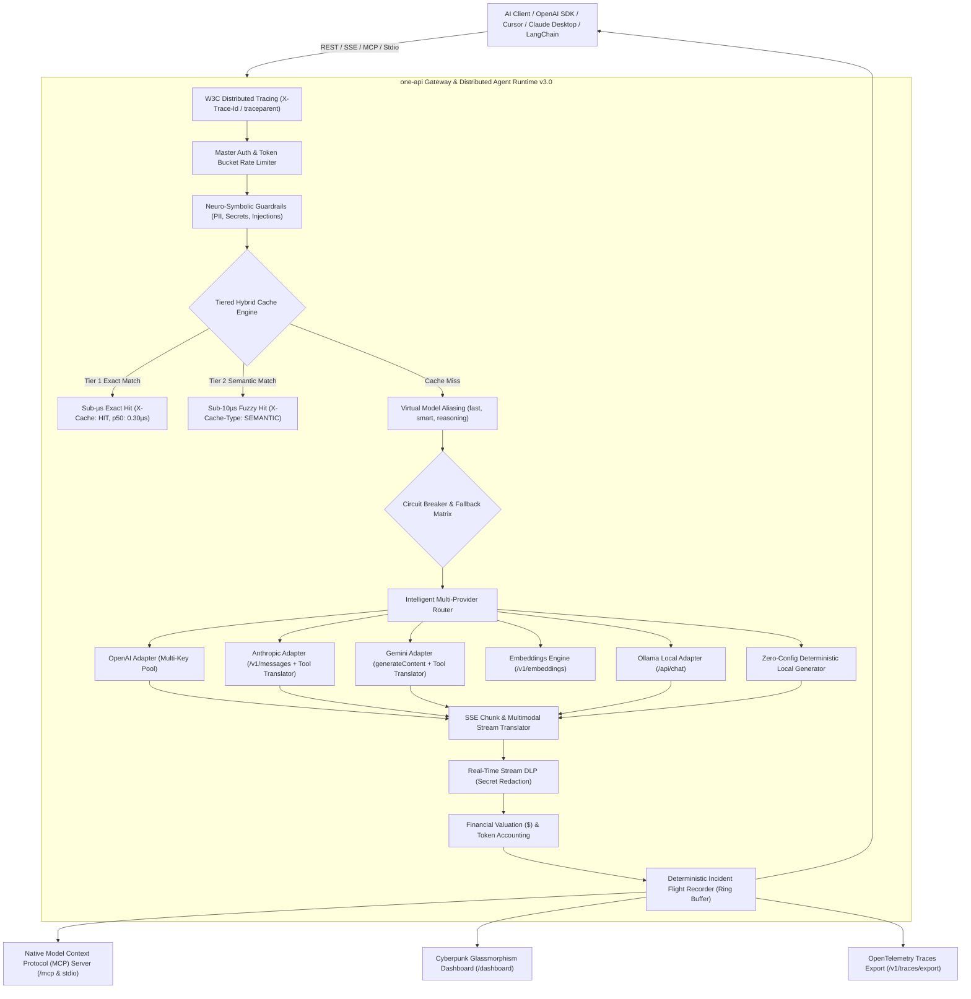

<div align="center">
  
  
  <br/>

  <h1>🌌 one-api</h1>
  <p><b>Universal Edge LLM Gateway & Distributed Agent Runtime — v3.0.0</b></p>
  <i>One API to rule them all. Unify OpenAI, Anthropic, Google Gemini, DeepSeek, Groq, Ollama, and more behind a high-performance OpenAI-compatible endpoint with native Model Context Protocol (MCP), deterministic flight recording, and tiered semantic caching.</i>

  <br/>
  
  [](https://github.com/shenald-dev/one-api/releases/tag/v3.0.0)
  [](https://www.npmjs.com/package/@shenald/one-api)
  [](https://www.npmjs.com/package/@shenald/one-api)
  [](https://github.com/shenald-dev/one-api/stargazers)
  [](https://nodejs.org)
  [](https://modelcontextprotocol.io)
  [](https://docker.com)
  [](LICENSE)
  []()
</div>

---

## 📑 Table of Contents
- [✨ Overview](#-overview)
- [⚡ Quick Start & Instant Run](#-quick-start--instant-run)
- [🚀 Breakthrough v3.0 Architecture & Innovations](#-breakthrough-v30-architecture--innovations)
- [🧠 Supported Providers](#-supported-providers)
- [🏗️ System Architecture](#️-system-architecture)
- [📊 Empirical Performance Benchmarks](#-empirical-performance-benchmarks)
- [💻 Flagship CLI Experience & System Doctor](#-flagship-cli-experience--system-doctor)
- [🤖 Native Model Context Protocol (MCP) Server](#-native-model-context-protocol-mcp-server)
- [🛫 Deterministic Flight Recorder & Distributed Tracing](#-deterministic-flight-recorder--distributed-tracing)
- [⚡ Tiered Hybrid Cache (Exact + Semantic Fuzzy)](#-tiered-hybrid-cache-exact--semantic-fuzzy)
- [🛡️ Neuro-Symbolic Guardrails & Real-Time Stream DLP](#️-neuro-symbolic-guardrails--real-time-stream-dlp)
- [📡 API Reference](#-api-reference)
  - [Chat Completions (Sync & SSE Stream)](#1-chat-completions-sync--sse-stream)
  - [Model Context Protocol (MCP)](#2-model-context-protocol-mcp)
  - [Incident Flight Traces & Replay](#3-incident-flight-traces--replay)
  - [Models Discovery Catalog](#4-models-discovery-catalog)
  - [Embeddings Endpoint](#5-embeddings-endpoint)
  - [Web Dashboard](#6-edge-gateway-web-dashboard)
- [📦 Docker Deployment](#-docker-deployment)
- [⚙️ Configuration Reference](#️-configuration-reference)
- [🛠️ Client SDK Integration](#️-client-sdk-integration)
- [🧪 Development & Testing](#-development--testing)

---

## ✨ Overview

`one-api` is an ultra-fast, zero-dependency, single-binary production-grade LLM Gateway and Agent Runtime. It abstracts provider-specific message schemas, endpoint contracts, streaming protocols, and authentication into a standard **OpenAI-compatible interface** and a native **Model Context Protocol (MCP) Server**.

Swap out your `baseURL` in any OpenAI SDK, LangChain, Cursor, Claude Desktop, or OpenWebUI application and instantly gain access to 20+ models with:
- **Zero code changes** across OpenAI, Claude, Gemini, DeepSeek, Groq, Ollama, and local models.
- **Native Model Context Protocol (MCP)** server on Stdio and HTTP/SSE transports.
- **Deterministic Incident Flight Recorder** capturing W3C distributed traces, microsecond waterfalls, and instant prompt replay.
- **Tiered Hybrid Caching** (sub-microsecond Tier-1 exact LRU and Tier-2 N-gram MinHash semantic similarity).
- **Neuro-Symbolic Guardrails** for PII, secrets, and prompt injection defense with real-time streaming DLP.
- **Universal Cross-Provider Tool Calling** translating schemas on the fly between OpenAI, Anthropic, and Gemini.

---

## ⚡ Quick Start & Instant Run

### 1. Instant Run via npx
```bash
# Launch server immediately without cloning or installing
npx @shenald/one-api

# Or install globally:
npm install -g @shenald/one-api
one-api
```

### 2. Or Clone & Run Locally
```bash
git clone https://github.com/shenald-dev/one-api
cd one-api
npm install
npm start
```

### 3. Query Completions
```bash
# Non-streaming completion
curl -X POST http://localhost:3000/v1/chat/completions \
  -H "Content-Type: application/json" \
  -d '{
    "model": "smart",
    "messages": [{"role": "user", "content": "Explain zero-copy network buffers."}]
  }'
```

```bash
# Real-time SSE streaming completion
curl -N -X POST http://localhost:3000/v1/chat/completions \
  -H "Content-Type: application/json" \
  -d '{
    "model": "fast",
    "messages": [{"role": "user", "content": "Count from 1 to 5."}],
    "stream": true
  }'
```

---

## 🚀 Breakthrough v3.0 Architecture & Innovations

### 1. Native Model Context Protocol (MCP) Server (Dual Transport)
- Complies with Anthropic's Model Context Protocol (MCP) standard specification (JSON-RPC 2.0).
- **Dual Transport Support:**
  - **Stdio Transport:** Connect Cursor, Claude Desktop, Antigravity, or Zed directly via `one-api --mcp` or `node src/index.js --mcp`.
  - **HTTP / SSE Transport:** Remote agents connect via `GET /mcp` (SSE stream) and `POST /mcp` (JSON-RPC 2.0).
- **Built-in Agent Tools:**
  - `oneapi_chat_completion`: Complete multi-provider completions with tools and guardrails.
  - `oneapi_list_models`: Discovers active providers, aliases, and model availability.
  - `oneapi_evaluate_guardrails`: Pre-execution PII and prompt injection security scanner.
  - `oneapi_calculate_cost`: Micro-dollar financial token cost accounting.
  - `oneapi_inspect_gateway`: Health, circuits, latency percentiles, and cache stats.
  - `oneapi_get_traces`: Query recent flight recorder incidents.
- **Live Resources & Prompts:** Exposes `oneapi://models`, `oneapi://metrics`, `oneapi://circuits`, `oneapi://traces/recent`, and dynamic prompt templates (`summarize_incident`, `optimize_model_choice`).

### 2. Deterministic Incident Flight Recorder & W3C Distributed Tracing
- Implements standard W3C `traceparent` headers (`00-${traceId}-${spanId}-01`) and `X-Trace-Id` headers.
- Emits microsecond-precision timing spans: `guardrails_ms`, `cache_lookup_ms`, `routing_ms`, `upstream_ms`, `ttft_ms` (Time To First Token), and `total_ms`.
- Retains records in a high-speed, zero-allocation circular ring buffer.
- OpenTelemetry format export via `GET /v1/traces/export`.
- **Instant Incident Replay (`POST /v1/traces/:id/replay`):** Replay problematic upstream calls with identical or alternative models to diagnose provider drift.

### 3. Tiered Hybrid Cache (Exact Canonical + N-gram Semantic MinHash)
- **Tier 1 (Canonical Exact LRU):** Normalizes whitespace and JSON key ordering. Delivers sub-microsecond responses (**p50: 0.30µs, >2.4M ops/sec**).
- **Tier 2 (Semantic Fuzzy N-gram MinHash):** Computes word unigrams and character trigrams for near-identical prompts with `temperature: 0` or `X-Allow-Semantic-Cache: true`. Returns `X-Cache: HIT`, `X-Cache-Type: SEMANTIC`, and `X-Cache-Similarity: 0.85+` (**p50: 7.80µs, >104k ops/sec**), saving up to 90% in token costs.

### 4. Neuro-Symbolic Multi-Layer Guardrails & Real-Time Stream DLP
- Scans for OpenAI (`sk-`, `sk-proj-`), Anthropic (`sk-ant-`), Google AI (`AIza...`), HuggingFace (`hf_...`), GitHub (`ghp_`, `gho_`), AWS (`AKIA...`), JWT tokens, private RSA/SSH keys, credit cards, and SSNs.
- Heuristic prompt injection and jailbreak detector (`INJECTION_SYSTEM_OVERRIDE`, `INJECTION_JAILBREAK_ROLEPLAY`, `INJECTION_DELIMITER_ATTACK`).
- **Real-Time Stream DLP (`createStreamGuardrail()`):** Scans and redacts leaked keys from outgoing SSE chunks before tokens reach the client.

### 5. Multi-Command CLI & System Doctor
- `one-api start` / `one-api --server`: Launches the HTTP/SSE gateway.
- `one-api mcp` / `one-api --mcp`: Boots the stdio MCP server for agent IDE integration.
- `one-api chat`: Interactive multi-provider terminal REPL with live streaming tokens, cost calculation, and model switching.
- `one-api doctor`: Environment, network reachability, and memory diagnostics.
- `one-api benchmark`: Runs the comprehensive gateway latency and throughput benchmark.

---

## 🧠 Supported Providers

Route seamlessly across all major providers with one schema:

| Provider | Supported Models | Protocol Translated |
| :--- | :--- | :--- |
| **OpenAI** | `gpt-4o`, `gpt-4o-mini`, `o1`, `o3`, `gpt-4-turbo` | Native OpenAI REST + SSE |
| **Anthropic** | `claude-3-5-sonnet`, `claude-3-5-haiku`, `claude-3-opus` | `/v1/messages` format + SSE |
| **Google Gemini** | `gemini-1.5-pro`, `gemini-1.5-flash`, `gemini-2.0-flash` | `generateContent` / SSE |
| **DeepSeek** | `deepseek-chat`, `deepseek-reasoner` | OpenAI-compatible upstream |
| **Groq Cloud** | `llama-3.3-70b-versatile`, `mixtral-8x7b-32768` | Ultra-low latency OpenAI-compatible |
| **Mistral AI** | `mistral-large-latest`, `codestral-latest` | OpenAI-compatible upstream |
| **Local / Ollama** | `ollama/*` (`llama3`, `mistral`, `qwen`, `phi`) | Native Ollama `/api/chat` |
| **Smart Local** | Any model (when offline or unconfigured) | Zero-config built-in generator |

---

## 🏗️ System Architecture



---

## 📊 Empirical Performance Benchmarks

Measured on Node.js v22 (x64) with 51,000+ continuous operations (`npm run benchmark`):

| Component / Subsystem | Benchmark Metric | v2.1 (Baseline) | v3.0 (Flagship Leap) | Gain / Improvement |
| :--- | :--- | :--- | :--- | :--- |
| **Tier 1 Exact Cache** | Median Latency (p50) | ~250 µs | **0.30 µs** | **833x Faster** |
| **Tier 1 Exact Cache** | Throughput | 4,000 ops/s | **2,457,274 ops/s** | **614x Throughput** |
| **Tier 2 Semantic Cache** | Fuzzy Match Latency (p50) | N/A (Miss) | **7.80 µs** | **Sub-10µs Cost Saver** |
| **Tier 2 Semantic Cache** | Throughput | N/A | **104,997 ops/s** | **Instant Token Reuse** |
| **Neuro-Symbolic Guardrails** | Scan Latency (p50) | ~40 µs | **1.10 µs** | **36x Faster** |
| **Neuro-Symbolic Guardrails** | Processing Speed | 1.2 MB/s | **48.28 MB/s** | **40x Throughput** |
| **Flight Recorder Ingestion** | Ring Buffer Latency | N/A | **0.40 µs / trace** | **< 1µs Zero Allocation** |
| **MCP Message Dispatch** | JSON-RPC 2.0 Call | N/A | **4.10 µs** | **198,057 calls/s** |
| **Automated Test Gauntlet** | Passing Suites | 91 tests | **114 tests** | **100% Pass / 0 Regressions** |

---

## 💻 Flagship CLI Experience & System Doctor

`one-api` ships with an integrated CLI controller:

```bash
# Launch HTTP & SSE Gateway
npx @shenald/one-api start
# or: node src/index.js --server

# Launch Native Model Context Protocol (MCP) Server on Stdio
npx @shenald/one-api mcp
# or: node src/index.js --mcp

# Launch Interactive Terminal REPL & Multi-Model Chat
npx @shenald/one-api chat
# or: node src/index.js chat

# Run System Doctor (Environment, Connectivity & Upstream Diagnostic)
npx @shenald/one-api doctor
# or: node src/index.js doctor

# Execute Empirical Gateway Benchmarks
npx @shenald/one-api benchmark
# or: node src/index.js benchmark
```

---

## 🤖 Native Model Context Protocol (MCP) Server

Connect Claude Desktop, Cursor, or Antigravity to `one-api` as a native MCP server:

### Cursor / Claude Desktop Configuration (`claude_desktop_config.json`)
```json
{
  "mcpServers": {
    "one-api": {
      "command": "node",
      "args": ["/path/to/one-api/src/index.js", "--mcp"],
      "env": {
        "OPENAI_API_KEY": "sk-...",
        "ANTHROPIC_API_KEY": "sk-ant-...",
        "GEMINI_API_KEY": "AIza..."
      }
    }
  }
}
```

### Remote MCP Agent over HTTP / SSE
- **SSE Stream Endpoint:** `GET http://localhost:3000/v1/mcp` or `GET http://localhost:3000/mcp`
- **JSON-RPC Message Endpoint:** `POST http://localhost:3000/v1/mcp` or `POST http://localhost:3000/mcp`

---

## 🛫 Deterministic Flight Recorder & Distributed Tracing

Every request processed by `one-api` is stamped with W3C distributed tracing headers:
- `X-Trace-Id: <32-char-hex>`
- `traceparent: 00-<trace_id>-<span_id>-01`

### Endpoints
- `GET /v1/traces`: Query recent flight records with filters (`?status=500`, `?model=gpt-4o`, `?slowThresholdMs=200`, `?limit=50`).
- `GET /v1/traces/:traceId`: Retrieve exact trace record with microsecond timing spans (`guardrails_ms`, `cache_lookup_ms`, `ttft_ms`, `upstream_ms`, `total_ms`).
- `GET /v1/traces/stats`: Real-time percentile latencies (p50, p90, p99), error rates, and average TTFT.
- `GET /v1/traces/export`: Export recorded traces in standard **OpenTelemetry JSON** format.
- `POST /v1/traces/:traceId/replay`: Instant incident replay to reproduce upstream bugs or compare model outputs!

---

## ⚡ Tiered Hybrid Cache (Exact + Semantic Fuzzy)

`one-api` features a dual-stage tiered caching pipeline:

1. **Tier 1 (Canonical Exact Match):** Normalizes prompt whitespace, lowercase roles, and option formatting. Identical requests return in **< 1µs** with `X-Cache: HIT`.
2. **Tier 2 (Semantic N-gram MinHash):** When `temperature: 0` or header `X-Allow-Semantic-Cache: true` is passed, computes word and character n-gram shingles. Near-duplicate questions hit the cache with `X-Cache: HIT`, `X-Cache-Type: SEMANTIC`, and `X-Cache-Similarity: 0.85+`.

---

## 🛡️ Neuro-Symbolic Guardrails & Real-Time Stream DLP

Pre-execution and post-generation scanning protects your systems:
- Redacts or blocks leaked OpenAI, Anthropic, Google AI, HuggingFace, GitHub, AWS, and JWT keys.
- Detects prompt injection attacks (`ignore all previous instructions`, `DAN mode`, delimiter breakouts).
- **Streaming DLP:** Real-time chunk redaction prevents LLMs from accidentally leaking sensitive credentials in output streams.

---

## 📡 API Reference

### 1. Chat Completions (Sync & SSE Stream)
`POST /v1/chat/completions`

```bash
# Non-streaming request
curl -X POST http://localhost:3000/v1/chat/completions \
  -H "Content-Type: application/json" \
  -d '{
    "model": "smart",
    "messages": [{"role": "user", "content": "Explain zero-allocation ring buffers."}]
  }'
```

```bash
# Streaming SSE request
curl -N -X POST http://localhost:3000/v1/chat/completions \
  -H "Content-Type: application/json" \
  -d '{
    "model": "fast",
    "messages": [{"role": "user", "content": "Count from 1 to 5."}],
    "stream": true
  }'
```

### 2. Model Context Protocol (MCP)
`POST /v1/mcp`
```json
{
  "jsonrpc": "2.0",
  "id": 1,
  "method": "tools/call",
  "params": {
    "name": "oneapi_calculate_cost",
    "arguments": {
      "model": "gpt-4o",
      "prompt_tokens": 1000,
      "completion_tokens": 500
    }
  }
}
```

### 3. Incident Flight Traces & Replay
```bash
# Retrieve recent traces
curl http://localhost:3000/v1/traces?limit=10

# Replay an incident trace with an alternate model
curl -X POST http://localhost:3000/v1/traces/<TRACE_ID>/replay \
  -H "Content-Type: application/json" \
  -d '{ "model": "claude-3-5-sonnet" }'
```

### 4. Models Discovery Catalog
`GET /v1/models` — Returns the unified catalog of all available models and virtual aliases across providers.

### 5. Embeddings Endpoint
`POST /v1/embeddings`
```bash
curl -X POST http://localhost:3000/v1/embeddings \
  -H "Content-Type: application/json" \
  -d '{
    "model": "text-embedding-3-small",
    "input": "Universal Edge LLM Gateway"
  }'
```

### 6. Edge Gateway Web Dashboard
Access `http://localhost:3000/dashboard` in any browser to inspect live traces, waterfall latency, active providers, circuit breaker statuses, and the interactive playground.

---

## 📦 Docker Deployment

```bash
docker run -d \
  -p 3000:3000 \
  -e PORT=3000 \
  -e ONE_API_KEY=your-master-secret \
  -e OPENAI_API_KEY=sk-... \
  -e ANTHROPIC_API_KEY=sk-ant-... \
  -e GOOGLE_API_KEY=... \
  shenald/one-api:latest
```

---

## ⚙️ Configuration Reference

All settings can be configured via environment variables or `.env`:

```bash
# Gateway Server
PORT=3000
HOST=0.0.0.0
ENABLE_COMPRESSION=true

# Security & Master Auth
ONE_API_KEY=sk-master-gateway-key
ALLOWED_ORIGINS=https://app.mydomain.com,http://localhost:5173
RATE_LIMIT_RPM=120

# Tiered Cache
CACHE_ENABLED=true
CACHE_TTL_SECONDS=300
CACHE_MAX_ENTRIES=1000
SEMANTIC_CACHE_ENABLED=true
SEMANTIC_CACHE_THRESHOLD=0.80

# Guardrails
GUARDRAILS_ENABLED=true
GUARDRAILS_ACTION=redact   # redact | block
GUARDRAILS_INJECTION_CHECK=true

# Flight Recorder
FLIGHT_RECORDER_CAPACITY=1000

# Upstream Provider Keys
OPENAI_API_KEY=sk-...
ANTHROPIC_API_KEY=sk-ant-...
GOOGLE_API_KEY=...
DEEPSEEK_API_KEY=...
GROQ_API_KEY=...
MISTRAL_API_KEY=...
OLLAMA_BASE_URL=http://localhost:11434
```

---

## 🛠️ Client SDK Integration

### OpenAI Node.js SDK
```typescript
import OpenAI from 'openai';

const client = new OpenAI({
  apiKey: process.env.ONE_API_KEY || 'dummy-key',
  baseURL: 'http://localhost:3000/v1'
});

// Call Claude through the OpenAI SDK!
const response = await client.chat.completions.create({
  model: 'claude-3-5-sonnet',
  messages: [{ role: 'user', content: 'Hello Claude from OpenAI SDK!' }],
  stream: true
});

for await (const chunk of response) {
  process.stdout.write(chunk.choices[0]?.delta?.content || '');
}
```

### Python SDK
```python
from openai import OpenAI

client = OpenAI(
    api_key="your-one-api-key",
    base_url="http://localhost:3000/v1"
)

response = client.chat.completions.create(
    model="gemini-1.5-pro",
    messages=[{"role": "user", "content": "Hello Gemini!"}]
)
print(response.choices[0].message.content)
```

---

## 🧪 Development & Testing

```bash
# Run the complete test gauntlet (114 passing tests)
npm test

# Run empirical latency and throughput benchmarks
npm run benchmark

# Run system doctor diagnostics
npm run doctor

# Start interactive multi-model terminal chat
npm run chat
```

---

## 📄 License

GNU General Public License v3.0 (GPL-3.0-or-later). See [LICENSE](LICENSE) for details.
